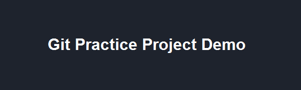

# Git Practice Project

[](https://github.com)


Учебный репозиторий для отработки полного цикла работы с Git, GitHub Actions, документацией и Pull Request.

## Демонстрация



## Быстрый старт

### Установка
```bash
git clone https://github.com
cd git-practice
pip install pytest
```

### Пример использования
```python
from app import add

print(add(2, 2))  # Вывод: 4
```

## Статус функциональности

| Фича | Описание | Статус |
| :--- | :--- | :---: |
| Калькулятор (pp.py) | Базовая функция сложения | ✅ |
| Автотесты (pytest) | Проверка кода через GitHub Actions | ✅ |
| REST API | Документация эндпоинтов в docs/API.md | 🚧 |
| Веб-интерфейс | Полноценный фронтенд | ❌ |

## Документация и ссылки
* [История изменений (CHANGELOG)](CHANGELOG.md)
* [Документация API](docs/API.md)
* [База знаний (Wiki)](https://github.com)

## Как помочь проекту (Contributing)
1. Сделайте форк репозитория или создайте новую ветку (git checkout -b feature/amazing-feature).
2. Зафиксируйте изменения (git commit -m "Add amazing feature").
3. Отправьте ветку в репозиторий и откройте Pull Request.

## Лицензия
Этот проект распространяется под лицензией **MIT**.
